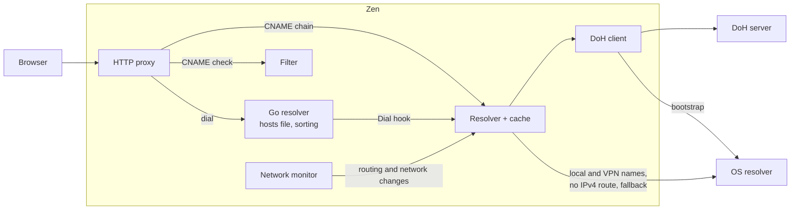

# Encrypted DNS and CNAME checks for the proxy

## Summary

Zen's HTTP proxy gets its own DNS resolver. It sends the proxy's lookups to a DNS-over-HTTPS (DoH) server the user selects, such as Quad9 or Cloudflare, instead of the OS resolver. The answers include CNAME records, so the proxy can also catch third-party trackers disguised via CNAME cloaking.

The design follows Firefox's DoH implementation: local names and names handled by a VPN go to the OS resolver, and so does any lookup that fails over DoH.

DNS filtering for apps that don't use the proxy is left to a separate RFC.

## Motivation

**DNS leaks browsing history.** The proxy resolves hostnames through the OS, which usually asks the ISP's DNS server in plaintext. Anyone watching the traffic can see each domain the user visits. Some ISPs also sell traffic data to third parties.

**CNAME cloaking.** A site can point a subdomain such as `metrics.news.example` at a tracker, usually run by a third party, with a CNAME record. Rules for the tracker's domain don't match the subdomain, and the OS resolver doesn't show Zen the CNAME. uBlock Origin catches this only on Firefox, and skips requests that go through an HTTP proxy.

## Impact

### Settings

A new **DNS server** setting:

- **System default**: the proxy uses the OS resolver, and runs no CNAME checks.
- **Presets**: Quad9, Cloudflare, Google, OpenDNS, all over DoH.
- **Custom**: a DoH URL (`https://…`).

The default is an open question, see [Unresolved questions](#unresolved-questions).

While Zen uses system DNS instead of the selected server, the setting says why: the server is unreachable (with the TLS error if the certificate failed verification), a VPN handles all DNS, or the network has no IPv4 route.

A second setting, **Use system DNS for these domains**, covers internal names not announced by the network.

### On upgrade

Existing installations start on System default.

### Performance and resources

- A lookup that misses Zen's cache costs one DoH round trip, usually over a connection that's already open.
- At a few hundred bytes per entry, a 10,000-entry cache takes a few megabytes.
- Each name in a CNAME chain costs one more pass over the blocking rules. Most hostnames have none or one.

## Design

### Overview

New Go packages, provisionally:

- `internal/dns/doh`: the DoH client.
- `internal/dns/resolver`: decides where each lookup goes, falls back, and caches answers.
- `internal/netmon`: reads the OS's search and match domains and VPN state, and reports changes.

DNS messages are parsed and built with `golang.org/x/net/dns/dnsmessage`.

### Resolver (`internal/dns/resolver`)

**Routing.** These names go to the OS resolver:

- single-label names (`nas`, `printer`)
- `localhost`, `local`, `home.arpa`, `internal` and `lan`, and names under them
- names under the OS's search and match domains (see [Network monitor](#network-monitor-internalnetmon)), except public suffixes such as `com`, which a network could announce to switch DoH off
- names under the user's **Use system DNS** domains

While a VPN handles all DNS, every name goes to the OS resolver, as Firefox does on Windows. Otherwise DoH would return public addresses for names answered differently by the VPN, such as `jira.corp.example`.

While the machine has no IPv4 route, every name also goes to the OS resolver. On an IPv6-only network, only the network's DNS synthesises IPv6 addresses for IPv4-only sites (DNS64), so DoH answers for those sites would be unreachable. Zen checks for a route with a UDP connect to a public IPv4 address, which looks up the route without sending anything, at startup and on each network change. With CLAT, as on macOS 13 and later, the machine has an IPv4 route and DoH works as usual.

`onion` names fail without a lookup ([RFC 7686](https://www.rfc-editor.org/rfc/rfc7686)). Every other name goes to the DoH server, with `A` and `AAAA` queries sent in parallel.

**Answers.**

- NXDOMAIN is final. See [Rationale and alternatives](#rationale-and-alternatives).
- `0.0.0.0` and `::` answers, and Extended DNS Errors 15, 16 and 17 (Blocked, Censored, Filtered, [RFC 8914](https://www.rfc-editor.org/rfc/rfc8914)), block the request. The proxy doesn't dial `0.0.0.0`, which can reach the local machine.
- Answers with private, loopback or link-local addresses are asked again of the OS resolver, as Firefox does (`network.trr.allow-rfc1918`). This keeps the router's DNS rebinding protection, and covers names that only resolve to a private address inside the network.
- If DoH fails, the lookup goes to the OS resolver. Each lookup has a total time budget for DoH, shared by all its attempts.

**Fallback mode.** After several DoH failures in a row, the resolver sends every lookup straight to the OS resolver, so lookups don't each wait out the time budget. It probes the DoH server every few seconds and switches back when a probe succeeds. This covers captive portals, provider outages and networks that block DoH.

### Cache

Go's resolver has no cache, so the resolver keeps an LRU cache for DoH answers, capped by entry count:

- Answers with addresses are kept until their TTL expires.
- NXDOMAIN answers and provider blocks are kept for their TTL, capped at five minutes, so a page retrying a blocked tracker doesn't send a DoH query each time. For NXDOMAIN, the TTL comes from the SOA record ([RFC 2308](https://www.rfc-editor.org/rfc/rfc2308)).

Expiry uses wall-clock time, because Go's monotonic clock stops during sleep on some platforms. The cache is cleared on a network change and when the server setting changes. Filter rules apply after the cache, so rule changes take effect on the next request. Zen doesn't cache answers from the OS resolver; the OS caches those.

### DoH client (`internal/dns/doh`)

**Requests.** Queries follow [RFC 8484](https://www.rfc-editor.org/rfc/rfc8484): `POST` requests with `application/dns-message` and message ID 0, over HTTP/2. Dialling pinned addresses needs a custom `DialContext`, which turns off `net/http`'s automatic HTTP/2, so the transport sets `ForceAttemptHTTP2`. `net/http` still checks the certificate against the URL's hostname. `Transport.Proxy` is nil, so DoH never goes through Zen's own proxy.

**Bootstrap.** Presets ship with the provider's IPv4 and IPv6 addresses. Zen also looks up the DoH hostname, preset or custom, through the OS resolver, and tries those addresses too, so an outage of one address range doesn't stop DoH. In [Cloudflare's 2025-07-14 incident](https://blog.cloudflare.com/cloudflare-1-1-1-1-incident-on-july-14-2025/), the 1.1.1.1 ranges went down but its DoH hostname stayed reachable.

**Padding.** Queries include the EDNS(0) Padding option ([RFC 7830](https://www.rfc-editor.org/rfc/rfc7830)), using the block-length policy from [RFC 8467](https://www.rfc-editor.org/rfc/rfc8467), so the size of an encrypted message doesn't give away the name.

**Failure.** On a connection error or timeout, the client closes that connection and retries on the next address, within the lookup's time budget. Only failures on fresh connections count towards fallback mode, so a dead connection after a wake doesn't start it. HTTP/2 pings (`HTTP2Config.SendPingTimeout`) detect dead connections.

### HTTP proxy integration

**Dialling.** The proxy opens all its connections through one `net.Dialer`: requests, tunnels and WebSockets. The dialer gets a `net.Resolver` with two settings:

- `Dial`: a hook that gives Go's resolver a connection to send its DNS queries over. Zen's hook returns an in-memory connection to Zen's resolver.
- `PreferGo`: without it, Go uses the OS resolver directly on macOS and Windows, and never calls the hook.

For example, when the proxy dials `news.example:443`:

1. Go looks up `news.example` in the hosts file. If it's there, Go skips to step 4.
2. Go sends `A` and `AAAA` queries over the in-memory connection.
3. Zen's resolver answers them from its cache or over DoH. For names routed to the OS, it answers with the OS resolver's result.
4. Go sorts the addresses ([RFC 6724](https://www.rfc-editor.org/rfc/rfc6724)) and connects to the first one. If that hasn't connected after 300 ms, Go also starts on the other address family ([RFC 6555](https://www.rfc-editor.org/rfc/rfc6555), since obsoleted by [RFC 8305](https://www.rfc-editor.org/rfc/rfc8305)).

RFC 6555 recommends remembering which address family worked, but Go doesn't. On a network with broken IPv6, each new connection therefore waits 300 ms before trying IPv4. The proxy's dialer already has this delay.

**CNAME check.** After a request passes the filter, the proxy asks the resolver for the hostname's CNAME chain. The check:

- covers every name in the chain
- skips names with the same registrable domain as the hostname, and requests to the page's own host, as uBlock Origin does
- skips tunnels not decrypted by Zen and answers from the OS resolver, which don't include the chain

For each name, the filter runs its blocking rules on a copy of the request, with that name as the host and no path. The copy gets its own context:

- Third-party status is worked out again. Zen normally reads it from the browser's `Sec-Fetch-Site` header, which describes the original request: `metrics.news.example` on `news.example` is same-site. EasyPrivacy lists most CNAME trackers as `$third-party` rules, such as `||eulerian.net^$third-party`, so with the header's answer those rules would never match. Instead, Zen compares the registrable domain of the CNAME name, `eulerian.net`, with the page's, `news.example`.
- The page for `$domain` comes from the original request.

An exception that allows the original request, such as `@@||metrics.news.example^`, skips the check, but `$important` blocking rules still apply. Exceptions that only modify requests, such as `$removeparam`, don't count.

A match blocks the original request. The request log shows the original URL, the CNAME name that matched and the rule. Its allow action adds an exception for the requested hostname, `@@||metrics.news.example^`. An exception for the tracker would unblock it on every site.

This needs a new filter function that checks blocking rules for a given context and also has no side effects like log events.

### Network monitor (`internal/netmon`)

The monitor reports two kinds of change:

- Routing: the search and match domains, and whether a VPN handles all DNS. The resolver updates where names go.
- Network: any change to interfaces, addresses or the default route, and waking from sleep. The resolver clears its cache and checks for an IPv4 route again, and the DoH client closes its connections.

Change events are noisy: switching Wi-Fi networks produces a dozen or so within a second or two. So the monitor debounces them by about a second, then reads the state again and reports a change only if it differs. It also re-reads the state every 30 seconds or so, in case an event was missed. A wake from sleep shows up as a jump in wall-clock time between two ticks.

| | Search and match domains | VPN handles all DNS? | Change events |
| --- | --- | --- | --- |
| macOS | `SCDynamicStore`: `SearchDomains` and `SupplementalMatchDomains` under `State:/Network/...`; file names in `/etc/resolver/` | the primary DNS service is a tunnel interface | `SCDynamicStore` notifications on `State:/Network/...` keys; file events on `/etc/resolver/` |
| Windows | `GetAdaptersAddresses` for connection-specific suffixes; the registry for the primary suffix, the suffix search list and NRPT rules | a VPN adapter with DNS servers holds the default route | `NotifyIpInterfaceChange`, `NotifyUnicastIpAddressChange`, `NotifyRouteChange2`; `RegNotifyChangeKeyValue` on those registry keys |
| Linux | systemd-resolved's `Domains` property over D-Bus, which includes routing-only domains; otherwise `search` in `/etc/resolv.conf` | a link has the routing domain `~.` | netlink link, address and route changes; resolved's D-Bus property changes; inotify on `/etc/resolv.conf` |

### Scenarios revisited

- On cafe Wi-Fi, the network sees no lookups, only the hostnames in TLS handshakes (SNI).
- `metrics.news.example` is a CNAME for `news-example.eulerian.net`, so `||eulerian.net^$third-party` blocks the request.
- A split-DNS VPN announces `corp.example`, so `wiki.corp.example` goes through the OS resolver to the VPN's DNS server.
- While a full-tunnel VPN is connected, every lookup goes to the OS resolver.
- On hotel Wi-Fi, lookups fall back to the hotel's DNS, which shows the login page. DoH resumes once the user logs in.
- After a laptop wakes, Zen clears the cache and redials DoH, so no lookup waits on a dead connection.
- On an IPv6-only network without CLAT, lookups go to the OS resolver, whose DNS64 answers let the proxy connect through NAT64.
- An NXDOMAIN answer from Quad9 blocks the request.

## Drawbacks

- A third-party resolver sees every name resolved by the proxy.
- Only the proxy's lookups are encrypted.
- CNAME checks only run on DoH answers, so they skip every lookup that goes to the OS resolver.
- CDN servers may be farther away than the ones the ISP's resolver would return.
- Without an NXDOMAIN fallback, an internal name not covered by any announced domain fails until the user adds its domain to **Use system DNS**.

## Rationale and alternatives

**System-wide DNS filtering in the same RFC.** It needs a privileged helper that binds port 53, redirects the OS's DNS settings and restores them after a crash. It also needs its own handling of VPNs, split DNS and captive portals on each platform. That's most of the risk and work, and the proxy needs none of it.

**Falling back on NXDOMAIN, as Firefox does.** It catches internal names not covered by any announced domain. But it undoes blocking by providers that answer NXDOMAIN, such as Quad9's malware blocking, and it sends typos to the network in plaintext. The **Use system DNS** list covers those internal names instead.

**DoH first for names under search domains, with NXDOMAIN fallback.** This would stop a hostile network from claiming a domain such as `paypal.com` as a search domain. But it sends every internal hostname to the provider. It also breaks split-horizon setups where the public zone has a wildcard record: `wiki.corp.example` gets the public wildcard address instead of falling back.

**Dialling the resolved addresses in Zen.** Zen would have to repeat address sorting, the IPv4 and IPv6 race, and hosts-file handling, which Go's resolver already does behind the `Dial` hook.

**Synthesising IPv6 addresses for NAT64, as Firefox does.** Firefox finds the NAT64 prefix by looking up `ipv4only.arpa` ([RFC 7050](https://www.rfc-editor.org/rfc/rfc7050)), and appends synthesised IPv6 addresses after the IPv4 ones in DoH answers, so DoH keeps working on IPv6-only networks. In Zen, Go's resolver would sort the synthesised addresses ahead of native IPv4, since RFC 6724 gives them higher precedence. On a dual-stack network that also runs DNS64, traffic would then go through NAT64 for no reason. Avoiding that needs the IPv4 route check anyway, and desktops with no IPv4 route and no CLAT are rare.

**Strict DoH with no fallback.** This is Firefox's "Max Protection". Captive portals and internal names would break, and users would learn to switch DoH off. An opt-in strict mode is an open question.

**DNS-over-TLS.** DoH already gives similar privacy and security: both encrypt queries with TLS and authenticate the server. But DoT uses its own port, 853, which a network can block with one rule, while DoH shares port 443 with all other HTTPS traffic. DoT would also need its own client with connection reuse and pipelining, while DoH reuses `net/http`. Every preset offers DoH.

**Plain DNS to a custom address.** Its main use, a LAN resolver such as Pi-hole, is usually the network's DNS server already, which System default uses.

**Libraries.** [`dnsproxy`](https://github.com/AdguardTeam/dnsproxy) and [`miekg/dns`](https://codeberg.org/miekg/dns) cover far more than a DoH client. `net/http` and `dnsmessage` are enough.

**Not doing this.** The proxy keeps leaking every visited domain to the network's DNS in plaintext, and CNAME-cloaked trackers keep getting through.

## Prior art

- **Firefox's [Trusted Recursive Resolver](https://firefox-source-docs.mozilla.org/networking/dns/dns-over-https-trr.html)**: the model for this RFC. In TRR-first mode, hosts-file names, names under the network's DNS suffix, and `localhost` and `local` go to the OS resolver. Firefox falls back when DoH fails or answers NXDOMAIN, and treats answers with private addresses as invalid. Its "confirmation" state is the model for fallback mode. On Windows it [turns DoH off when it detects a VPN or NRPT rules](https://wiki.mozilla.org/Trusted_Recursive_Resolver).
- **Chrome's [Secure DNS](https://blog.chromium.org/2020/09/a-safer-and-more-private-browsing.html)**: automatic mode falls back to the OS resolver and retries DoH later. Choosing a specific provider turns the fallback off. Secure DNS is turned off in managed environments.
- **uBlock Origin's [CNAME uncloaking](https://github.com/gorhill/uBlock/wiki/Advanced-settings)**: on Firefox only, through the `browser.dns` API. It checks only the final name in the chain. It replays only the origin through the filter, skips first-party names and requests to the page's own host, and skips requests allowed by an exception. It doesn't uncloak requests sent through an HTTP proxy, since the proxy resolves those. Zen follows these rules, apart from checking the whole chain.
- **Tailscale's [`net/netmon`](https://github.com/tailscale/tailscale/tree/main/net/netmon)**: watches network changes on each platform, and detects waking from sleep by a jump in wall-clock time.

## Security & privacy considerations

**Who sees lookups.** With a DoH server selected, the provider sees every hostname sent by the proxy. The OS resolver, and with it usually the network in plaintext, still gets:

- local names, names under search and match domains, and names under the user's **Use system DNS** domains
- every lookup while a VPN handles all DNS or the machine has no IPv4 route
- names whose DoH answer has a private address
- every lookup during fallback mode, and single lookups whose DoH attempts fail
- the DoH hostname at bootstrap, which tells the network which provider the user chose

Hosts sent `DIRECT` by the PAC script, such as banks, `accounts.google.com` and the user's exclusions, never reach the proxy. The browser resolves them through the OS, as it does when the proxy is unreachable and the PAC script's `; DIRECT` fallback applies.

Zen never writes lookups to disk.

**Downgrade by a network attacker.** An on-path attacker can block DoH to force fallback mode, and with it plaintext DNS. [RFC 8310](https://www.rfc-editor.org/rfc/rfc8310) defines two privacy profiles for DNS over TLS: strict, which never falls back to plaintext, and opportunistic, which may. In those terms, this design is opportunistic, like Firefox's TRR-first mode and Chrome's automatic mode, and the settings show each fallback.

**Answers from a hostile network.** A network can still answer the lookups that go to the OS resolver. That includes names under a search domain announced by the network, such as `paypal.com`. This is no worse than without DoH, and TLS still authenticates the server.

**DNSSEC.** Zen doesn't validate DNSSEC. It trusts the encrypted channel to the provider, like other stub resolvers.

## Unresolved questions

To resolve during RFC discussion:

- **The default DNS server.** It could be System default or a preset. A preset gives every user encrypted DNS and CNAME checks, but sends every visited hostname to a provider the user didn't choose. Among presets, the candidates are Quad9 (non-profit, Swiss jurisdiction, blocks known-malicious domains) and Cloudflare (no filtering on the base endpoint).
- **A strict mode** with no fallback, for users who prefer failed lookups over plaintext DNS.

To resolve during implementation:

- **VPN detection and Windows sources**: confirm how to tell that a VPN handles all DNS on each platform, and where Windows keeps the primary suffix, the suffix search list and NRPT rules, including those set by Group Policy.
- **Timing and size numbers**: the DoH time budget per lookup, the number of failures that starts fallback mode, the probe interval, the cache size, and the time jump that counts as a wake.

Out of scope:

- DNS filtering for apps outside the proxy
- DNS-over-TLS, DNS-over-QUIC and DNSCrypt
- DNSSEC validation

## Future possibilities

- A separate RFC can add system-wide DNS filtering and encrypted DNS for every app, reusing the DoH client and resolver.
- CNAME checks could work without DoH, through platform APIs that return DNS records: `DnsQueryEx` on Windows, `DNSServiceQueryRecord` on macOS, and systemd-resolved's `ResolveRecord` on Linux.
- Synthesising IPv6 addresses for NAT64 would keep DoH working on IPv6-only networks without CLAT. [RFC 9872](https://www.rfc-editor.org/rfc/rfc9872) recommends taking the prefix from router advertisements ([RFC 8781](https://www.rfc-editor.org/rfc/rfc8781)), which few OSes expose to apps, and falling back to `ipv4only.arpa`.
- Reading `HTTPS` records ([RFC 9460](https://www.rfc-editor.org/rfc/rfc9460)) would give ECH configuration and ALPN hints for upstream connections.
- DNS-over-QUIC ([RFC 9250](https://www.rfc-editor.org/rfc/rfc9250)) could become an upstream option once its Go ecosystem matures.
